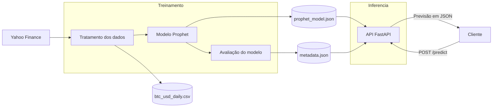
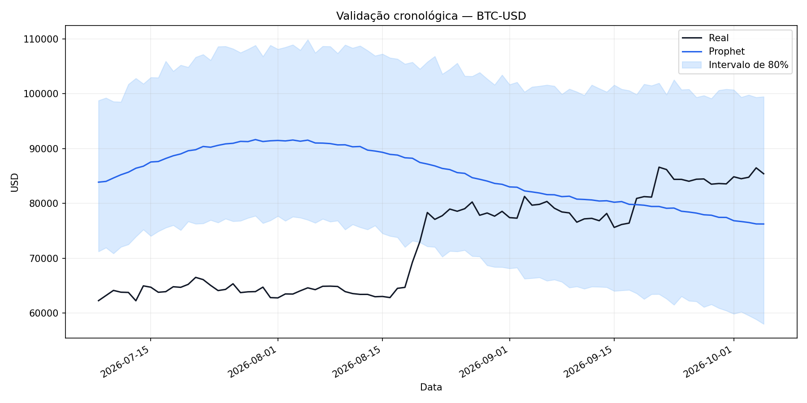

# Ponderada de computação docker e UMl 

## arquitetura da solção



aqui a primeira arquitetura simples que eu pensei e pedi para o chatgpt criar o codigo mermaid para mim. 
### explicação da arquitetura
então o objetivo e começar pegando os dados do bitcoin do yahoo finance, ai ele vai para o primeiro container que vai tratar os dados treinar o modelo e avaliar ele com as metricas escolhidas,ai o pipeline treinado passa para o proximo container, junto com as métricas. ai no outro container vai ser onde o modelo e a api vao estar. ai a gente faz a requisição da predição para a api e ela vé o que o modelo previu e manda para o cliente. 

### Diagrama de sequencia

``` mermaid 
sequenceDiagram
    autonumber

    actor Dev as Desenvolvedor
    participant Trainer as Container de Treinamento
    participant Yahoo as Yahoo Finance
    participant Data as data/btc_usd_daily.csv
    participant Artifact as artifacts/prophet_model.json
    participant Metadata as artifacts/metadata.json
    participant API as Container de Inferência
    actor Client as Aplicação Cliente

    rect rgb(0, 1, 2)
        Note over Dev,Metadata: Fase 1 — Treinamento do modelo

        Dev->>Trainer: Executa o treinamento via Docker
        Trainer->>Yahoo: Solicita histórico diário do BTC-USD
        Yahoo-->>Trainer: Retorna datas e preços de fechamento

        Trainer->>Trainer: Limpa e ordena os dados
        Trainer->>Data: Salva uma cópia do histórico
        Trainer->>Trainer: Aplica logaritmo ao fechamento
        Trainer->>Trainer: Separa treino e teste cronologicamente
        Trainer->>Trainer: Treina e avalia o Prophet
        Trainer->>Trainer: Calcula MAE, RMSE e MAPE
        Trainer->>Trainer: Retreina usando todo o histórico

        Trainer->>Artifact: Exporta o modelo em JSON
        Trainer->>Metadata: Salva métricas e configurações
        Trainer-->>Dev: Informa resultado do treinamento
    end

    rect rgb(0, 0, 0)
        Note over Dev,Client: Fase 2 — Inicialização do backend

        Dev->>API: Inicia o container de inferência
        API->>Artifact: Carrega o modelo Prophet
        Artifact-->>API: Retorna o modelo serializado
        API->>Metadata: Carrega configurações e metadados
        Metadata-->>API: Retorna ticker, período e transformação

        alt Artefatos carregados corretamente
            API-->>Dev: Serviço iniciado
        else Artefato ausente ou inválido
            API-->>Dev: Erro de inicialização
        end
    end

    rect rgb(0, 0, 0)
        Note over Client,API: Fase 3 — Utilização da API

        Client->>API: GET /health
        API-->>Client: 200 OK — serviço ativo

        Client->>API: POST /predict com data ou horizonte
        API->>API: Gera datas futuras
        API->>API: Executa model.predict()
        API->>API: Reverte o logaritmo com exp()
        API-->>Client: Previsão, limites e moeda em JSON
    end
```
 


ai aqui está o diagrama de sequencia uml, de uma forma mais entendivel do que eu falei antes apenas com o diagrama da arquitetura.

## modelo

ai depois eu comecei a pensar no modelo e como tratar os dados e avaliar ele né. então como sugerido pelo professor eu usei a biblioteca Prophet para fazer as predições, que o objetivo é saber o preço do bitcoin. ai eu estou coletando os dados do site tambem proposto pelo professor: yahoo finance. ai eu estou pegando um janela de 2018 ate 2026. 
ai esses dados todos foram tratados, ordenando eles por data, removendo valores nulos e invalidos e passando o preço para um escala logaritmica, pois o bitcoin varia muito no tempo da janela que estou usando.
ai teve a separação dos dados, os 90 dias mais recentes são os testes e os outros milheres de dias são o treino.
e ai configurar o modelo e testar ele né, para testar ele foi utlizada as métricas MAE: para metrificar os erros médios do modelo, RMSE: é parecido com o MAE só que ele vai penalizar mais os erros grandes(as duas métricas calculam o erro em dolar) e o MAPE para erro percentual médio. ai os resultados foram:
- MAE: US$14.848,92
- RMSE: US$18.002,76
- MAPE: 22,26%
e teve uma acuracia de 52,22%
o que não são muito boas metricas, ou seja, o modelo não se saiu tão bem assim né. Ele só se saiu um pouco melhor do que uma escolha aleatória.
comparando com a baseline: 
- MAE: US$9.422,55
- RMSE: US$12.595,06
- MAPE: 11,81%
ou seja o Prophet não superou a baseline, isso mostra que ele conseguiu fazer as predições mas teve uma certa dificuldade em acompanhar as mudanças do bitcoin

aqui um grafico de como o modelo se saiu em relação aos valores reais do teste: 


ai depois da avaliação é criado um modelo que vai usar todo o dataset para as previsões. sem separa uma parte de teste.
ai depois de gerar esse modelo foi gerado uma predição para ver como ele se saia: 
```
{
  "date": "2026-10-06",
  "predicted_close": 73819.85,
  "predicted_lower": 63521.05,
  "predicted_upper": 86634.84,
  "currency": "USD"
}
```

ai ele tenta prever o valor médio para o dia seguinte apos os dias do dataset. com isso é possivel notar um que teve um intervalo grande entre predicted_lower e predicted_upper isso quer dizer um incerteza no modelo, se fosse mais proximas as predições isso iriam dizer que ele está mais certo do que ele preveu.

## back

depois de criar o modelo e testar e pá, chegou a parte de fazer o back, a api de consulta da predição. foi usado o FastAPI para criar o servisor http.
ai nessa parte localiza os artefatos de infomações do modelo e o modelo treinado e ai com isso carrega o modelo, isso acontece quando a API inicia, ai se alguma dessas informações não forem validas ou ausente a API não inicia.
o endpoint de predição é: POST /predict e ai na hora de fazer a predição o clinte deve enviar:
```
{
  "days": 3
}
```
com o quanto de dias ele quiser prever, mas os dias deves estar na janela de 1 a 30 dias, fora desse escopo a api retorna erro 422, falando que o numero deve ser igual ou maior a 1 e menor que 30.
a resposta que a previsão gera é:
```
{
  "ticker": "BTC-USD",
  "currency": "USD",
  "generated_at_utc": "2026-10-05T18:37:38+00:00",
  "predictions": [
    {
      "date": "2026-10-06",
      "predicted_close": 73819.85,
      "predicted_lower": 63446.01,
      "predicted_upper": 85427.22
    }
  ],
  "disclaimer": "Predição experimental; não constitui recomendação financeira."
}
```
foi criado tambem um endpoint de saude, que verifica se o modelo foi carregado e se o serviço está ativo, o GET /helth que deve retorna: 
```
{
  "status": "ok",
  "model_loaded": true,
  "ticker": "BTC-USD",
  "trained_until": "2026-10-05"
}
```
no compose a porta mapeada que vai roda a solução foi a 8000:8000. então para acessar: http://localhost:8000


### dependencias 
as dependencias do projeto são:

### Treinamento

- `prophet`: criação e treinamento do modelo.
- `yfinance`: obtenção do histórico do Yahoo Finance.
- `pandas`: organização e tratamento dos dados.
- `numpy`: transformação logarítmica e cálculo das métricas.
- `matplotlib`: geração do gráfico de validação.

### Backend

- `fastapi`: criação e validação dos endpoints.
- `uvicorn`: servidor HTTP da aplicação.
- `prophet`: carregamento e execução do modelo.
- `pandas`: criação das datas futuras.
- `numpy`: reversão da transformação logarítmica.

## Como executar a solução

Para executar o projeto é tem que ter o Docker e o Docker Compose instalados. Todos os comandos aqui devem ser executados na pasta raiz, onde está o arquivo `docker-compose.yml`.

### 1. Treinar o modelo

Para baixar os dados do Yahoo Finance, tratar os dados e treinar o modelo Prophet:

```bash
docker compose run --rm trainer
```

quando acabar, o treinamento gera os seguintes arquivos:

- `data/btc_usd_daily.csv`: histórico utilizado no treinamento;
- `artifacts/prophet_model.json`: modelo Prophet treinado;
- `artifacts/metadata.json`: configurações e métricas do modelo;
- `results/validation_predictions.csv`: previsões do período de teste;
- `results/validation_plot.png`: gráfico da validação;
- `results/next_day_prediction.json`: exemplo de previsão.

Também é possível executar o treinamento utilizando o CSV já salvo, sem baixar novamente os dados:

```bash
docker compose run --rm trainer \
  --input-csv data/btc_usd_daily.csv
```

### 2. Iniciar o backend

Depois que os artefatos forem gerados, o backend pode ser construído e iniciado com:

```bash
docker compose up --build -d api
```

A opção `-d` mantém o container executando em segundo plano.

A API ficará disponível no endereço:

```text
http://localhost:8000
```

A documentação interativa do FastAPI pode ser acessada pelo navegador em:

```text
http://localhost:8000/docs
```

### 3. Verificar a saúde da API

Para confirmar que o serviço está ativo e que o modelo foi carregado:

```bash
curl http://localhost:8000/health
```

Resposta esperada:

```json
{
  "status": "ok",
  "model_loaded": true,
  "ticker": "BTC-USD",
  "trained_until": "2026-10-05"
}
```

### 4. Solicitar uma previsão

O endpoint `/predict` recebe a quantidade de dias que devem ser previstos. O campo `days` aceita valores entre 1 e 30.

Exemplo solicitando a previsão dos próximos três dias:

```bash
curl -X POST http://localhost:8000/predict \
  -H "Content-Type: application/json" \
  -d '{"days": 3}'
```

Exemplo de resposta:

```json
{
  "ticker": "BTC-USD",
  "currency": "USD",
  "generated_at_utc": "2026-10-05T18:37:38+00:00",
  "predictions": [
    {
      "date": "2026-10-06",
      "predicted_close": 73819.85,
      "predicted_lower": 63446.01,
      "predicted_upper": 85427.22
    },
    {
      "date": "2026-10-07",
      "predicted_close": 73909.83,
      "predicted_lower": 63306.28,
      "predicted_upper": 85945.96
    },
    {
      "date": "2026-10-08",
      "predicted_close": 73545.17,
      "predicted_lower": 63178.23,
      "predicted_upper": 85543.76
    }
  ],
  "disclaimer": "Predição experimental; não constitui recomendação financeira."
}
```
# dificuldades
uma das principais dificuldades foi como o Prophet se saiu, que não foi muito bom, ele não conseguiu aconpanhar bem as mudanças rapidas do bitcoin. tem teve que corrigir a comparação entre os modelos, que que os dois usassem apenas os dados disponeiveis antes do teste
outra dificuladade foi salvar o modelo corretamene, que eu descobri que o Prophet recomenda que seja salve como JSON por algum motivo.e tambem para evitar problemas com a conexão do yahoo finance, os dados são salvos em CSV, para permitir rodar de forma offline.